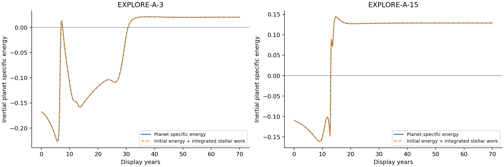
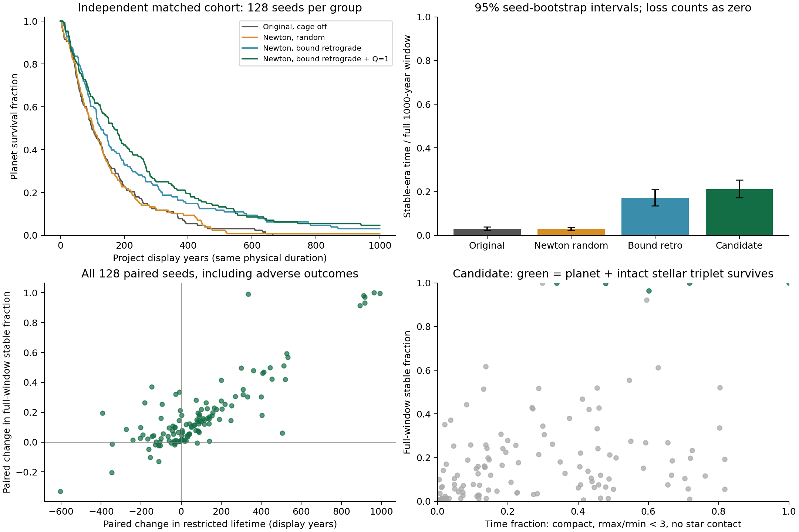
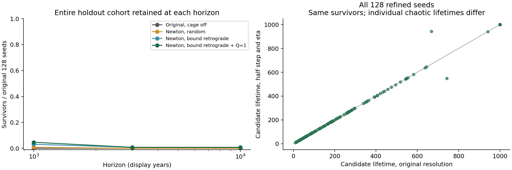
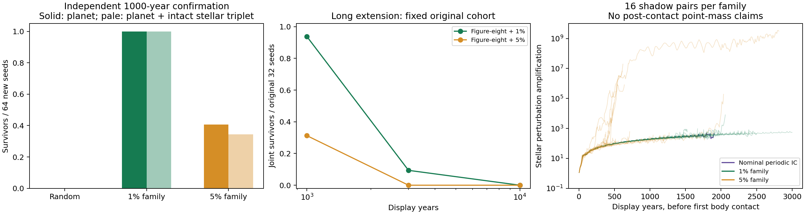

# 无牢笼三星行星长期存活研究

日期：2026-10-20（Asia/Shanghai）。源码基线：`c7a53a01def5f9d60389ee20ec0f8bac5210ed69`；结束前再次核实远程 main 仍为此提交。研究分支：`research/newtonian-survival`。

## 结论

**纯牛顿条件下，合理设计初值能够显著提高有限窗口的存活和恒纪元占比；本研究尚未找到同时保持强混沌、非层级、完整三星，并具有高比例长期行星存活的可靠方案。**

最接近主要目标的随机三星改进，在128个全新匹配种子、1000显示年内，将平均受限寿命从146.22提高到244.37年，恒纪元占比从2.90%提高到21.20%。但期末只存活6/128，保持三星完整的只有5/128；延长到10000年仅剩1/128。该改善真实、可重复，但不足以称为普遍长寿解决方案。

靠近已知非层级“8字形”轨道族，1%扰动方案在64个全新种子中达到1000年64/64完整存活、约100%恒纪元，证明非层级构型本身并不排斥大幅改善。然而其敏感性主要接近规则轨道对照；原32个探索种子延长到10000年全部发生目标损失。不能把这一结果冒称为长期强混沌方案，也不能从这些有限模拟推导纯牛顿在所有初值中不可能成功。

研究完成2440条主试验，另有影子轨迹、逐步收敛、独立参考和长窗扩展。完整队列及程序哈希审计通过：[DATA_AUDIT.json](docs/research/results/DATA_AUDIT.json)。未修改 `src/`、生产测试、依赖清单或部署配置；未合并 main。

## 1. 实际运行模型与统计口径

运行链为 `main.js → simulation-worker.js → Simulation → legacy/008.js`。研究复用实际初始化器和 `WorldState`，并以独立驱动提高批量统计效率。完整审计见 [SOURCE_AUDIT.md](docs/research/SOURCE_AUDIT.md)。

- 实际默认初始化为 chaotic，而非旧版 balanced；默认启用牢笼。所有研究组显式关闭牢笼。
- chaotic 初始化的三星初始维里比 `Q=2K/|U|` 为.65–.95；行星使用全局随机速度，并未专门构造低偏心、隔离良好的宿主轨道。
- 三星质量各5e6、行星5000，`G=1.3275440274585598e-8`。主要比较保留这些质量、物理半径及恒纪元参数。
- 原力在 `.1<r<.28` 的一段区间增强吸引力，`.28`左侧约4倍牛顿力、右侧1倍。它不是普通Plummer软化。修复组采用平方反比牛顿力，不加其他约束力。
- 原积分器为Yoshida四阶分裂，默认步长.00075，每参考帧最多10步。减小步长时，研究增加步数，绝不减慢物理演化。
- 驱动器保留距零点1e−5的除零保护；有效目标区间的接触半径远大于该值。保护区内及接触后的点质量运动不作为纯牛顿长期成功证据，未用该保护机制稳定任何主比较结果。

**时间：**本报告的“年”均指项目显示年。默认每显示年推进.45求解器时间单位；10000显示年不是经过天体物理完整标定的10000真实年。主确认集初始平均交叉时长约16.05显示年，1000/10000年约为62/623个这样的初始时标。

**行星首次损失：**沿用默认距离阈值6，记录行星离四体质心越界，或原WorldState的吞噬、潮汐结构终态。越界时若同时正瞬时系统相对比能、向外运动，标记为“正能逃逸代理”；否则单列越界，不假称已证明无穷远逃逸。原产品 `shared.tj` 检查任意天体，故另记全系及恒星越界，避免把恒星逃逸误报为行星逃逸。

**恒纪元：**完全沿用实际WorldState：主星相对束缚、引力优势>1.5、其他恒星潮汐扰动<.35，并确认1/12显示年，保留原迟滞。主指标为“损失前恒纪元时间/完整观察窗口”，损失之后记0，不只计算幸存片段。

**三星约束：**额外报告联合存活：行星未损失、三星未越界、未发生按名义半径之和计算的恒星接触。还报告紧致非层级代理：三星距恒星质心≤6且三条星距最大/最小<3。这个几何代理不是严格的动力学层级判据，更不是Lyapunov证明。行星绕单颗恒星的小轨道不等于层级三星；后者才是被排除的替代目标。

所有种子按事前连续编号生成，无提前积分筛种；保留全部失败。独立确认不复用探索前缀。扩展窗口只重算尚存活个体，原分母保持不变；已知首次损失后恒纪元继续为0，这是吸收结局的计算复用，不是种子筛选。

## 2. 频繁损失的原因与直接证据

### 2.1 真实能量交换，不能靠守恒修复消除

三星总能量为负，不要求每个天体一直负能；恒星运动形成时变势，行星可从恒星轨道获得能量。

在完整探索队列之后，仅为机制诊断选取A-3和A-15两例，保持全部主试验种子不变。惯性四体质心系满足：

`d[vp²/2 − Σ(GMi/ri)]/dt = Σ[GMi (ri−rp)·vi / |ri−rp|³]`。

|案例|行星初始比能|70年后比能|积分恒星做功与能量增量的残差|全系能量最大相对误差|
|---|---:|---:|---:|---:|
|EXPLORE-A-3|−.16712|+.02039|2.63e−11|2.23e−13|
|EXPLORE-A-15|−.10925|+.12875|5.63e−12|1.08e−13|

诊断窗口内没有星体接触；A-15最小星—行星距离约.0864，仍在默认接触阈值之外。因此存在真实牛顿弹弓/能量交换，不能全部解释为积分器制造的假逃逸。两个后验案例不用于估计总体发生率。

### 2.2 初始负能不足，轨道角动量、位置与扰动环境同样重要

最初怀疑“随机行星普遍未束缚”，但阶段1的32个随机行星均至少对一颗恒星有负相对能量，**该泛化被数据否定**。它们相对最近主星的初始偏心率中位数为.818，18/32大于.8；负能并不等于有安全近心距和扰动裕量。

32个新种子的独立消融，在400年内：原随机平均寿命182.12年；仅修速度155.71年；仅把位置放近但保留随机速度35.19年；位置与相对圆轨道速度一起修复187.99年。后者恒纪元从12.9%提高到36.4%，但存活数7/32并未高于随机的8/32。不能把“加圆轨道速度”当充分解决办法。

### 2.3 恒星系统自身衰变和有限体积判定

主确认原始组的128个首次损失中：53个正能逃逸代理、48个其他越界、23个吞噬、4个潮汐破坏。候选组仍有42个正能逃逸、25个其他越界、29个吞噬、26个潮汐破坏，6个期末幸存。

主星近遇、束缚交换、恒星外逸、近心掠过会破坏行星；即便行星随宿主仍形成二体束缚对，也不满足完整紧致三星目标。原产品未实现恒星碰撞并合，接触后的点质量续算不是可信的真实三星演化预测。

### 2.4 原分段力与数值误差确实有问题，但不是唯一根因

原力的加速度边界跳变使默认积分下对应势能误差达到百分数量级。数值控制24种子中，默认原力误差中位数4.04%，步长缩到四分之一后仍为.91%。

纯牛顿也不能只依赖固定步长：极近遇后的能量误差可非常大；其中不少发生在行星已损失或恒星已接触之后，不能倒推为首次逃逸的原因。严格局部自适应显著控制误差，却没有消除大多数损失。

## 3. 各因素的贡献与可信度

|因素|控制变量观察|可信度与限制|
|---|---|---|
|总能量、维里比|Q=.5易冷塌缩；Q1.4在200年表现较好，但400年不如Q1的组合方案|中等；总负能不足。改变Q同时改变角动量幅度，不能把全部效应单独归给能量|
|恒星总角动量、方向|固定恒星动能增加共转，并未普遍提高联合存活；近8字族反而接近零总角动量|中等；不存在“总角动量越大越好”的本组证据，轨道相位关联也重要|
|行星位置与切向/径向速度|位置和宿主速度需同时设计；切向速度增加20%在阶段2显著变差；径向分量效果依赖相遇相位|位置/速度联合效应较强；单个速度最优值仅探索性|
|宿主相对能量与角动量|低偏心、较深的宿主轨道明显提高恒纪元；.12D逆向比.2D部分组合更好|有限窗口较强；逆向单项优势不是独立充分证明，不能阻止宿主近遇或全系衰变|
|恒星/行星质量|不等质量未优于主候选；行星质量10倍变化同时改变潮汐自引力阈值。恒星总质量×.5/2在匹配动力学窗口均5/32存活，与锚点相同|本范围内有限；未验证真实恒星质量—半径—光度一致性，不推广为普适最优质量|
|距离尺度|×2在同显示年内看似更好，延长2^(3/2)倍后优势消失|较强的时标混淆证据；固定阈值6还使相对边界改变，不能直接当严格尺度不变比较|
|初始几何和整个轨道族|近8字族使1000年结果大幅改善，新64种子复现|有限窗口证据很强；不是只改三角形形状，包含位置—速度关联，且混沌程度和长期表现受限|
|真实弹弓|直接做功积分解释负能→正能，而总能误差约1e−13|机制证据强；案例诊断不是总体贡献百分比|
|积分器、步长与软化|严格牛顿自适应控制误差；全128候选精细复算存活判定一致|有限窗口数值稳健性强；不保证某条混沌轨迹的长期损失时刻精确|

这些因素相互作用，现有试验不支持把总失败率机械拆成独立的百分比贡献。

## 4. 最有效的方案与定量比较

### 4.1 保持随机非层级三星目标的有限改进

冻结候选为：保留随机三维三星位置，去质心漂移，将恒星Q设为1；预定宿主为第3颗星，不依寿命选择；行星半径取该宿主最近恒星距离D的.12倍，构造宿主相对逆向圆轨道，并加入质量反冲。保持G、质量、物理半径、牢笼关闭及全部判定。初始圆轨道满足 `ε=−G(M+m)/(2r)`、`h²=G(M+m)r`。

使用精确牛顿力和Yoshida四阶驱动，近遇时按引力/穿越时标细分，最大步长.00075、eta=.0075。变步长后不宣称全局严格辛性，精度由实际守恒与收敛检验支持。

|1000年、128个匹配新种子|期末行星存活|三星联合存活|平均受限寿命|全窗恒纪元|
|---|---:|---:|---:|---:|
|原随机+原力，关闭牢笼|0/128|0/128|146.22|2.90%|
|原随机+精确牛顿|1/128|0/128|147.48|2.89%|
|宿主逆向圆轨道，原Q|4/128|2/128|217.65|17.05%|
|冻结候选Q1|6/128|5/128|244.37|21.20%|
|候选最大步长和eta再减半，全128复算|6/128|5/128|244.98|20.97%|

候选相对原始：平均受限寿命增加98.15年，配对种子bootstrap95%区间[53.62,146.06]；全窗恒纪元增加18.30百分点，[14.34,22.65]；期末存活增加4.69百分点，[1.56,8.59]。存活配对6赢0输，精确McNemar p=.03125，事件稀少，不能夸大。

6/128存活率的Wilson95%区间约[2.17%,9.85%]；0/128的上限仍约2.91%，不是证明总体成功概率为零。自助法以种子为单位、10000次重采样，不把时间帧当独立样本。

|同一128种子队列、期末存活数|1000年|3000年|10000年|
|---|---:|---:|---:|
|原随机+原力|0|0|0|
|原随机+牛顿|1|0|0|
|宿主逆向圆轨道，原Q|4|1|1|
|冻结候选Q1|6|1|1|
|全队列精细分辨率候选|6|1|1|

10000年候选的全窗恒纪元约2.98%，原始约.29%；平均受限寿命332.02年对146.22年。仍是改善，但不是高比例长期存活。未将唯一幸存种子作为新初始化器中心，也未围绕其筛选邻近成功种子。

### 4.2 最强的有限窗口非层级对照：近8字轨道族

标准等质量8字三体初值按相同G与质量缩放，位置尺度1.6；所有行星保留完整引力反作用。用各分量独立随机扰动生成整族，不进行寿命预筛选；行星仍为.12D的局部圆轨道。总角动量近零时只称固定平面负向轨道，不冒称相对整个三星的逆行。

|64个全新匹配种子、1000年|行星存活|三星联合存活|平均受限寿命|全窗恒纪元|
|---|---:|---:|---:|---:|
|随机牛顿基准|0/64|0/64|163.81|3.67%|
|8字族1%扰动|64/64|64/64|1000|约100%|
|8字族5%扰动|26/64|22/64|715.33|约70.0%|

64/64的Wilson95%下界约94.3%，不是总体100%的保证；该边界情况下bootstrap会退化，不能把[100%,100%]当可靠概率区间。

但在原32种子整队列延长中，1%组从1000年的30/32联合幸存降到3000年的3/32、10000年的0/32；5%组为10/32→0/32→0/32。10000年两组行星首次损失结局也均已知为0/32幸存，其中一条首次正能逃逸后发生的近奇点数值中断，不影响已知吸收结局。

这不是当前主要目标的成功方案：小扰动组在有效物理区间没有显示足够强的混沌证据；增大扰动提高敏感性，却明显降低长期完整性。

## 5. 混沌程度与长期存活的权衡

层级对照在阶段1的200年窗口32/32存活，但紧致非层级占比为0，所以从未计为主要目标成功。

近8字族另用16个连续新种子/组，施加恒星位置1e−9影子扰动，观察到3000年。只在首次任意星体几何接触之前解释敏感性：

|初值族|接触前达到1e4倍微扰放大的例数|接触前达到1%相对分离的例数|接触前最大放大倍数中位数|
|---|---:|---:|---:|
|名义周期初值|0/16|0/16|约478|
|1%扰动|0/16|0/16|约678|
|5%扰动|6/16|1/16|约571，分布有很长尾|

这支持“小扰动组的高存活与接近规则轨道有关”，但不是对其严格零Lyapunov指数的证明。5%组的一些轨迹有强敏感性，但不能把已逃逸/层级化的恒星运动或接触后的点质量运动算作目标持续成功。1000年主候选仅3/128同时达到联合存活和超过半窗的紧致非层级代理。

目前观察到的权衡是：减少强近遇、靠近规则轨道族，有利于行星长期保持宿主；允许更剧烈的三星交换和近遇，会增加真实能量交换、吞噬、结构损伤或宿主/恒星逃逸。该权衡不等于数学上不存在长寿混沌区域。

## 6. 是否有必要引入人为引力机制

**没有证据证明人为引力在物理上“必要”。** 本研究没有证明纯牛顿下不存在所需初值族；事实上已复现显著有限窗口改善，也观察到少数10000年幸存。

但若产品目标是让广泛随机、剧烈混沌的三星永远保持紧致，并保证高比例行星持续生存，当前纯牛顿试验没有给出可靠保证。应在真实逃逸/损失、自然重建宇宙、较规则的初值族和额外人为约束之间做明确产品选择；牢笼是改变物理模型的选择，不能包装成数值修复。

当前最有证据支持的研究建议，是先采用正确宿主参考系初值、合理局部束缚、明确Q与完整系统诊断，去除近距增力并控制积分误差；保留真实损失。任何合入产品的修改都应另行审核，本分支未进行合并或正式物理代码改动。

## 7. 数值验证、限制与下一步

验证包括：与实际求解器500帧位置/速度最大差约1.2e−14；实际Simulation与研究主指标差不超过1帧；独立SciPy DOP853参考；同物理时长的四阶收敛；二阶Verlet交叉检查；生产9个测试文件通过。

初次DOP853对照中随机近遇轨迹在默认步长的状态差3.40e−6，减半/四分之一后为2.15e−7/1.35e−8，未隐瞒初次容差失败。主候选首次损失/恒星接触前的最大相对能量误差2.51e−8，完整精细复算降至1.56e−9。128例期末存活和联合存活判定均相同，平均寿命差.61年，但单条寿命最大差273年：统计改善可重复，不代表轨迹级长期预言精确。

两条10000年原试验曾达到研究程序5e6步预算。这是数值中断，不是死亡；原文件保留，增大预算后两条均存活到10000年。最终长窗结论只引用 `extended-10000-v2.jsonl`。几何长窗另有一条在已观察到正能逃逸、随后恒星接触后，点质量近奇点导致步长过小而停止；后续动力学未验证，首次损失结果已知。所有统计明确区分物理损失与未解决的数值中断。

尚未解决的边界：

1. **有限样本与有限时窗。** 128种子和10000显示年不证明所有牛顿初值不可能；独立几何确认止于1000年，几何长窗使用完整原探索队列32例，二者没有混称。
2. **混沌的严格刻画。** 几何代理和影子分离不是无限时Lyapunov谱、长期非层级稳定性证明；需更长的有效区间、变分方程或多方向扰动分析。
3. **接触后物理。** 产品没有恒星合并、流体潮汐和质量损失模型。接触后继续四个点质量不能给真实三星寿命结论；若要求保留三星，接触已使该目标失败。
4. **参数标定。** 若照源码长度/质量单位作字面SI换算，默认行星质量约1e27kg、半径约1e10m，质量—半径组合并不代表正常行星；温度还另用距离倍数。本文是项目模型内的证据，未完成真实天体质量、半径、光度和气候的一致标定，也未靠缩小半径或隐藏行星取得主比较结果。
5. **未搜遍初值空间。** 真正四体周期解附近的延拓、星—行星反作用补偿、其他非层级长寿族、近遇正则化及物理一致的天体参数仍值得研究。不能把本次Q和几何扫描当穷举。

后续优先级应是：明确真实物理标定与“强混沌”的可检验指标，再检验新的初值族；对少数长寿区做独立新种子统计与收敛，不能围绕已知幸存种子筛邻域冒充无筛选方案。进一步扩大时窗前，先解决接触后的模型适用性，而不是继续积分已不符合目标的四点质量系统。

## 8. 复现与恢复

所有配置、原始逐种子JSONL、manifest哈希、统计程序、分阶段假设与结论均在 [docs/research/](docs/research/README.md)。恢复入口是 [STATUS.md](STATUS.md)。阶段1/2、数值控制、独立确认、全队列精细复算、几何新种子确认及长窗扩展均有Git checkpoint。

普通批处理逐种子fsync，重新执行同一配置会跳过已有键；哈希不匹配或尾部截断会报错，避免混合不同版本。冻结的engine版本用于重现旧阶段；扩展文件明确标注继承吸收结局，不能把每一行都称为重新积分到窗口末。

本研究的最终判断是：**有限窗口的大幅改善已经得到证据支持；在保留目标混沌程度的前提下，高比例长期成功仍未得到证明。当前证据不支持宣称必须使用引力牢笼，也不支持宣称纯牛顿已经彻底解决问题。**
