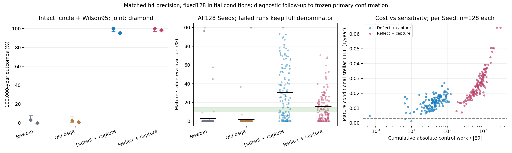

# V2科学阶段综合报告（集成验证继续中）

2026-10-22 UTC。研究分支research/minimal-chaos-control-v2；计算源7f64a8a、原生二进制SHA256 cf2117ac290bea83d6cfbdb07f98888412d594024e295887bc537bce5132f091。main未修改、未合并，私有网页未发布。本报告汇总已经完成的科学证据，不宣告JS正式壁纸已通过长期验收；当前恢复入口仍为STATUS.md，最终交付报告将在移植诊断评审后完成。

## 实测范围与核心结论

已按1000→10000→30000→100000年逐级探索，并在选型冻结后，对128个未用于调参的新Seed进行100000显示年确认。后续default/h2/h4是同128初值的数值复测，不增加独立Seed数；含同精度基准共1280个不同Seed/profile键，UNKNOWN0。提前恒星失败保留，绝不冒称其已跑满100000年。所有逐Seed结果、源码/配置/输入/原始及状态SHA、原注册初值与逐字段审计保留。

原始主确认：转向+捕获、反射+捕获均128/128三星完整；预定连续参与混沌联合终点分别121/128与125/128。成熟恒纪元均值28.21%和17.60%，不压低超过目标的结果。主确认及置信区间在CONFIRMATION_RESULTS.md。

同h4精度复核：

| 方案 | 完整三星 | 连续混沌联合 | 全窗恒纪元均值 | 成熟恒纪元，全128 | 成熟恒纪元，三星幸存者 |
|---|---:|---:|---:|---:|---:|
| 纯牛顿 | 4/128 | 0/128 | 见逐Seed表 | 3.25% | 84.49%，仅4例 |
| 原引力牢笼 | 3/128 | 1/128 | 见逐Seed表 | 1.90% | 78.84%，仅3例 |
| 转向+弱束缚捕获 | 128/128 | 122/128 | 31.24% | 30.91% | 30.91% |
| 反射+弱束缚捕获 | 128/128 | 126/128 | 17.17% | 15.26% | 15.26% |

新控制器A的Wilson95%区间均97.09%–100%；联合终点转向90.15%–97.83%、反射94.48%–99.57%。h4成熟均值bootstrap95%转向约26.11%–35.87%、反射12.65%–18.05%。这是128随机宇宙的总体统计，不保证单个宇宙满足恒纪元占比或混沌要求。基准幸存者高度选择性，不能用其84%/79%代替低全队列表现。旧牢笼仍有1例联合成功，完整保留。

图中原始512行同h4结果、统计及SHA来源在results/precision-baselines/；PNG/PDF可独立导出。图与区间是确认后的描述性数值复核，不冒称新的预注册主确认。

## 1. 原牢笼不足与瓦解原因

原牢笼在天体已经取得较高逃逸能量且远离后才回拉，不能直接防止致命三星近遇；高速回穿又增加碰撞机会。开牢笼时产品原观测会跳过逃逸判断，因此研究使用独立失效观察器，防止“未报告逃逸”等同成功。h4牛顿101次恒星接触、23次分离；旧牢笼125次恒星接触。基准终止/右删失时间中位数约640.65和572.57显示年。

混沌近遇把束缚能在紧双星与第三星之间交换；形成更紧双星时释放能量，可把第三星弹出。近径向角动量过低的相遇导致真实半径接触。逃逸不是单纯越过距离6：还要求星群簇分离、向外、相对能量显著为正并持续3年；另观察三星共同瓦解。数值下限/预算停止单列UNKNOWN。详见FAILURE_MECHANISMS.md及逐事件历史。

## 2. 候选、机制与失败记录

研究比较无控制、原牢笼、短程势垒、速度反射、按正能量或不同弱负能阈值捕获、能量再分配、预判近心距转向及其组合；初始化消融与行星不重生消融单列。只做远端捕获不能防碰撞；只防碰撞不能阻止能量交换导致的外逸；强势垒或频繁回拉会显著改写动力学。没有删除被淘汰版本、弱阈值失败或观察器调试历史。配置与结果分别见controllers/、MEDIUM_RESULTS.md、LONG30_RESULTS.md、WEAK30_RESULTS.md、INTERIM_REPORT.md、EXPERIMENT_LOG.md。

两个最佳折中方案共享事件型捕获：第三星向外运动、距离超过初始尺度与另外两星分离尺度的门槛，且Jacobi比能量高于−GM/(8初始尺度)，才降低外逸径向能量至−GM/(4初始尺度)。反冲保持动量平衡，移除动能再注入另两星的相对径向运动。常态不施力，未规定路径；但能量再分配仍会改变轨迹与部分角动量，须计成本。

反射方案只在极危险入射距离<1.15倍最大物理半径和时逆转径向相对速度。转向方案在距离<4倍半径和、预判近心距<1.15倍时，保持相对速率并小幅改变方向，将目标近心距移至1.3倍；极端时仍由反射兜底。保护阈值不是修改真实碰撞半径，接受步线段接触依然是失败。无8字形、拉格朗日解、寿命筛Seed、整宇宙自动重置或固定轨道脚本。

## 3. 混沌证据与局限

采用10年归一化、无量纲eps1e-8的恒星条件影子轨迹有限时间Lyapunov率；条件是主轨迹行星损失/重生外部历程，并非完整四体无限时间Lyapunov谱。配合最紧束缚双星身份交换、最近星对交换、非层级几何占比、动态层级持续时间和逐1000年分段指标。

预冻结联合规则要求完整三星、成熟FTLE>.003/年、最紧双星身份交换≥20、最长动态层级<1000年；进一步要求最长几何隔离≤5000年、成熟非层级占比≥.1。所有未通过的6例转向和2例反射h4宇宙保留，不能仅因三星存活就计为混沌成功。指标提供可测敏感性及持续相互作用证据，不是数学上永不周期化的证明；控制器的非光滑脉冲也可能贡献局部敏感性，不能把FTLE单独当成自然牛顿混沌。

## 4. 人为成本及最小干预权衡

| h4，128Seed均值或所注统计 | 转向+捕获 | 反射+捕获 |
|---|---:|---:|
| 激活帧占比均值 | 0.002224% | 0.008207% |
| 累计绝对分项做功/初始能量绝对值均值 | 47.26 | 821.64 |
| 累计顺序额外冲量均值 | 1.441×10⁸ | 6.328×10⁹ |
| 净控制角动量改变量归一化范数均值 | 0.15214 | 0.01142 |
| 同一控制事件合并后峰值速度跳变，全种子最大 | 0.5951 | 2.8550 |

有符号净功接近0来自能量再分配，绝不表示零干预；分项绝对功、顺序冲量、净/累计角动量和事件合并峰值均分别报告。脉冲没有指定持续时间，有限“峰值加速度”无定义；原连续加速度积分字段0只表示未使用附加连续力。所有数值残差必须扣除实测控制功与行星外部功。

转向具有更低累计功、冲量及激活频率，并给出较高恒纪元；代价是更明显角动量漂移和稍多混沌联合不足。反射角动量偏移较低、联合比例稍高，但累计人工作用显著更大。两者互不支配；不能称任一方案已达到绝对最小干预。优先进一步检验守角动量的近遇保护、事件级约束优化与更温和的弱束缚能量交换，同时必须新冻结参数并换新确认Seed，不能用当前128结果继续调参后仍称独立确认。

## 5. 行星与文明独立结局

h4转向平均行星损失/重生39.73次，反射52.13次；缺席占比分别0.1985%、0.2604%，缺席全程恒纪元记0。原始行星完整存活仅1/128与0/128；原始文明完整存活均0/128。文明存在帧占比均值19.77%和13.15%，不等于原文明长寿或人类持续存活。

P5协议在真实吞噬、潮汐终结或确认行星逃逸后移除行星质量，至少5显示年后按固定宿主轮换/黄金角相位/局部逆向圆轨规则生成新行星，记录全部外部功、冲量、P/L；三星时钟不重置。无重生消融成熟恒纪元趋0，故B有赖合理独立行星续生，不能声称控制器保护了原始宜居行星。新行星25年内成熟恒纪元贡献约0.72与0.98个百分点，不是删除不利时间段制造高占比。未放宽原WorldState纪元条件或伪造温度。

## 6. 数值与性能可信度

100000显示年=45000求解器单位；h4每条至少2.4亿名义Yoshida四阶步，近遇还增加子步，没有通过年倍率跳算。默认/h2/h4最大步长与eta依次减半，保持控制和初值一致。独立DOP853短窗与守恒校验、无渲染原生优化、同初值一致性、内存/速度记录见既有数值文档及原始结果。h4原生100k候选单Seed中位墙钟约202–210秒，最大RSS约18.2–21.1MiB；依具体轨迹和环境而变，不代表浏览器性能。

h4采样能量残差最大转向6.54×10⁻⁹、反射1.17×10⁻⁸；这不是连续时间误差上界。各精度A与混沌结论较稳健，恒纪元更敏感：转向成熟均值default28.21%、h2 36.44%、h4 30.91%，反射17.60%、16.52%、15.26%。转向h4-h2差−5.53个百分点、配对bootstrap95%约[−11.54,+0.39]，不能以含0证明等价或精确收敛。反射同差−1.26、约[−4.61,+2.12]。应将恒纪元作为有数值不确定性的总体估计；足以支持改善及超过期望下界，尚不能给出精确且与实现无关的单值。

## 7. 实际集成、复现与待完成项

完整可选运行原型已在integration/minimal-chaos-control-v2、/workspace/2-integration实现，main未改。包括接受步选择前控制、P5、失效吸收、事件/快照/文明/纪元、UI设置与行星尾迹处理。10类20年独立原生夹具通过，轨迹、接受步数、事件/生命周期、文明计数及预算均核对；最大末态差约1.6×10⁻¹⁰。Chromium实际Worker/WebGL兼容检查通过；发现的构建、HUD、滑块和恢复容器类型失败日志及截图保留。

4新诊断Seed×两原型的1000年均三星完整且UNKNOWN0，7/8未保持严格原生末态一致，最大单Seed恒纪元差约1.53个百分点；小能量残差不能抹去该差异。Node测得约1642–5733帧/秒、RSS约85–127MiB，含每帧快照/文明/计时且与浏览器共享2CPU，不当成独立硬件基准。不是新的100000年JS验证。

当前继续同4初值的1000/10000/30000年、冻结源码和配置的完整状态批处理。所有几何/周期退化、行星/文明/干预和UNKNOWN保留。JS本轮条件影子FTLE尚未实现，不能宣称JS混沌联合成功；后续还需独立长期统计复核、完整精度/性能评审及真实Wallpaper Engine宿主验收。原生研究成绩不能自动当成JS产品验收，现阶段不建议直接覆盖main。

复现：先读STATUS.md与各PROTOCOL；按build-native.sh构建冻结native（版本/编译选项/哈希独立核对），运行各队列的preflight/audit以审计已有数据，仅缺失键才恢复积分。独立原始文件及输入/状态SHA可从results/审查。JS原型在其分支执行npm test、npm run build、V2_NATIVE=/path/to/frozen/native node tools/validate-v2-native.mjs <新结果目录>；完整恢复/验证命令见docs/integration-v2/STATUS.md。不要将此报告覆盖根目录V1的FINAL_REPORT.md。

最终正式替换须先集成验证、完整旧版回滚提交/标签、保留研究全部历史、明确旧设置语义变化，再由用户最终验收。额度重置自动继续与环境无限持久性未得到保证；目前依靠磁盘/Git状态、哈希拒绝混写和已配置恢复检查，不把这些说成永不中断保证。

## 2026-10-22 JS移植30k与匹配原生后续证据

独立集成JS4诊断Seed×两模式均真正运行30000年，全部完整、UNKNOWN0；成熟恒纪元均值8.03%和3.88%，未达到B期望。随后同初值、同h4/参数、冻结原生二进制/条件影子的8条匹配对照亦均完整、UNKNOWN0，但成熟均值32.82%和11.93%。差异与所有失败/成本/行星结局保留；4例不能辨别总体波动、反馈舍入敏感或实现统计差异，不能预先认定长期等价。

JS条件恒星影子/动态层级已实现并通过主轨迹无影响、主+影子完整恢复逐位一致、10类原生20年夹具；条件FTLE最大短窗差约4.44e-5/年，非长窗误差上界。产品事件账补齐每次捕获/转向/反射的速度、功/冲量/P/L及事件净峰值，未调整控制参数。已固定全新128个JS确认Seed（只初始化、0积分步、128唯一且无244既往初值重合），继续同参数真正100000年JS确认，不以原生128Seed成绩替代产品验收。当前恢复命令及完整证据在集成STATUS/JS_CONFIRMATION_PROTOCOL，研究未结案。

## 2026-10-26 JS独立128Seed100000年确认完成

独立集成JS新128Seed×两候选全部256长期/1024窗口完成，来源/原始/状态/初值及真实时间步数重审计PASS、UNKNOWN0。三星完整各128/128，严格混沌联合118/128和124/128，成熟恒纪元33.99%（95%bootstrap29.16–39.06%）和19.08%（15.83–22.65%）；只联合通过者31.16%和16.71%。全部失败门槛原值、高恒纪元但混沌不足样本保留。各组完整率Wilson95%97.09–100%，联合92.19%/96.88%，联合Wilson86.22–95.70%/92.24–98.78%。这是真实JS长窗确认，不能再说JS只有短窗证据；也不能据此消除原生精度敏感性或宣称无限长期稳定。

JS累计绝对控制功约47.42/851.68倍初始能量，激活帧比例0.002228%/0.008390%，稀少并不意味着累计干预小。行星损失均45.75/58.703次，原始行星1/128和2/128、原始文明均0。P5 external.impulse字段为动量模长变化累计，不能当作完整矢量跳变冲量；原数据/净deltaP/deltaL与能量账保留，限制如实报告。完整报告与逐Seed成本/权衡图在独立集成工作树docs/integration-v2/JS_CONFIRMATION_RESULTS.md和results/js-confirmation-review-20261026/。

当前继续固定前32同初值h8数值诊断，原方法步长/eta减半，主影子一致加密、≥4.8亿主步/100k；不是新独立确认，不调控制/P5或覆盖原成绩。真实Wallpaper Engine宿主及P5完整矢量冲量仍未验证，研究未结案、main不改，正式替换依然等待完整证据和用户验收。
